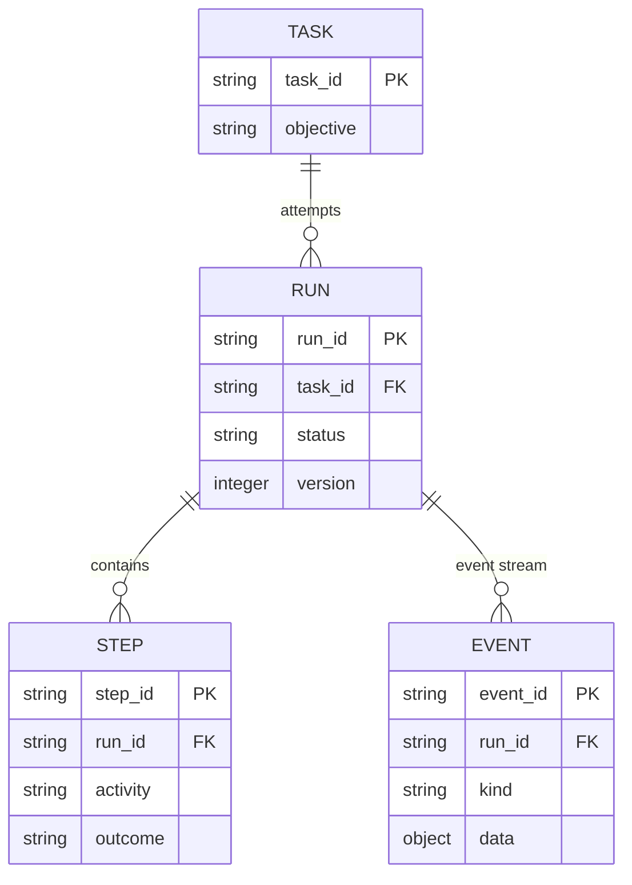
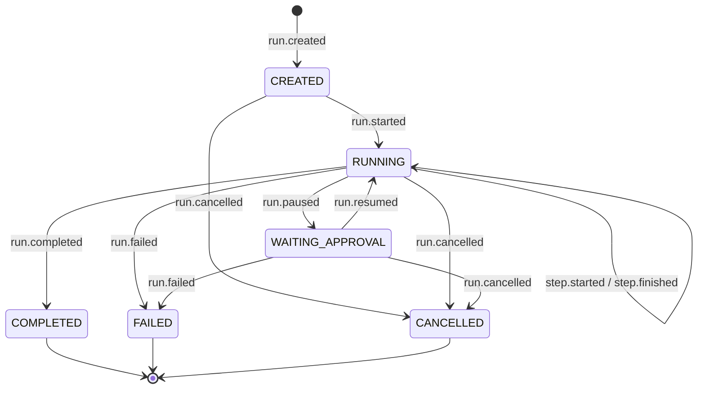
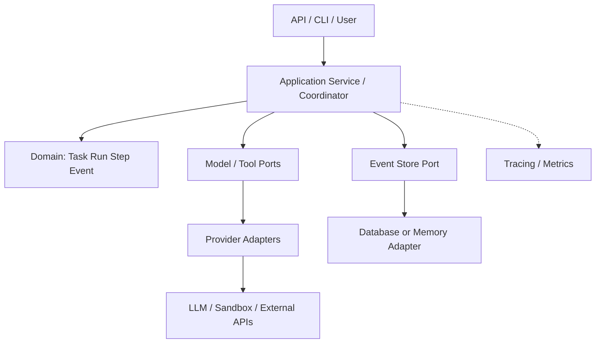

# 第 5 章：Agent 的软件架构设计

> **本章主线**：从一个可以运行的 Agent Loop，逐步设计 Task、Run、Step、Event 的领域模型、合法状态转移、事件回放以及可检测的并发冲突。
> **实验条件**：Python 3.11+，标准库即可。示例没有数据库、消息队列或后台 Worker；所有结果可在离线环境重现。
> **源码仓库**：https://github.com/apsaras-ai/agent-from-scratch

在第 4 章，我们实现了 `AgentKernel`。它能调用模型、执行工具、读取工具结果，甚至限制模型和工具调用次数。若仅运行一个几秒钟的 Agent，这已经足够。

但当你开始开发一个真正的 Agent 平台，很快会遇到另一组问题：

- 用户重新提交同一个需求，是重复任务，还是原任务的一次重试？
- Agent 模型调用失败，应该终止整次运行还是只重试当前 Step？
- 用户请求审批前，任务应该处于什么状态？收到审批后如何恢复？
- 两个 Worker 同时认为自己有权推进同一个 Run，谁的写入有效？
- 进程重启以后，我们如何知道它**已经做过什么**，避免重新发送消息或再次修改文件？
- 如果要做 Debugger、Evaluation 和 Trace，哪些状态应该记录成事件，哪些只是派生视图？

答案不是“再加一个 while 循环”，而是建立明确、可验证的**领域模型（Domain Model）与运行边界**。

本章首先设计一个小型 Agent Runtime 的“控制平面”领域模型。我们只实现内存事件流与状态投影，不实现分布式可靠执行。这样可以理解结构与不变量，而不会一开始就被数据库、Kubernetes 和分布式事务淹没。

## 5.1 从脚本式 Agent 到可演进的系统

### 5.1.1 第 4 章实现的价值与限制

```python
result = AgentKernel(model, tools).run("Calculate (8 + 13) * 2")
print(result.output)
```

这段代码适合教学和可信的单机任务。但它将任务生命周期隐藏在一次阻塞的函数调用内。调用方只能在函数结束后获得 `RunResult`。它没有显式的**任务身份、运行身份、持久化状态、审批状态和并发版本**。

考虑：

```
User API
  → Run 101 started
  → Tool call executes remotely
  → API connection closed
  → User retries request
  → Run 101 or Run 102?
  → Duplicate tool execution?
```

如果没有领域模型，系统很可能在“任务”、“请求”、“执行尝试”、“工具调用”和“日志”之间使用同一个 ID。这在简单 Demo 里似乎无害，但生产中可能导致重复付费、状态错乱、无法取消和审计失败。

### 5.1.2 本书采用的架构原则

1. **业务意图与执行尝试分离**：Task 表示要做什么，Run 表示一次实际尝试。
2. **控制状态显式化**：状态转移只通过有限集合内的事件进行。
3. **模型建议与工具执行分离**：领域模型不直接让任意模型文字产生副作用。
4. **可观察性与业务状态分离**：Tracing 用来解释发生了什么，Run State 用于判断现在能做什么。
5. **最小可验证核心**：纯函数计算状态，副作用只留在外围适配器。
6. **先保证单 Run 的一致性，再讨论多 Worker 分布式执行**。

这并非宣称每个 Agent 都必须 Event Sourcing。对于只执行一次、无审批、无恢复要求的小工具，一个数据库行加简单状态字段可能已足够。本章用事件流，是因为它能把状态变化与可复现实验清晰地联系起来。

## 5.2 设计领域词汇：Task、Run、Step、Event

### 5.2.1 不能把四者混成一张表

| 对象 | 代表的事实 | 推荐身份 | 典型生命周期 |
| --- | --- | --- | --- |
| Task | 用户/系统希望完成的目标 | task_id | 创建 → 完成或废弃 |
| Run | 对一个 Task 的某次执行尝试 | run_id | created → running → terminal |
| Step | Run 内一次可描述的模型/工具操作 | step_id | active → succeeded/failed |
| Event | 已经发生的状态变化事实 | event_id | append-only，不原地改写 |

**Task ≠ Run**：一个 Task 可以因为超时、失败后重试或使用不同模型而对应多个 Run。两个 Run 的历史和结果必须独立。

**Step ≠ Tool Call**：Step 是系统层面的执行记录，可以是模型推理请求、检索或工具执行；Tool Call 是模型/协议层的一次动作提议。一次模型响应可能包含多个 Tool Calls，这些 Tool Calls 应有各自的协议调用 ID。为方便本章演示，我们把模型回复与各工具观察映射为各自的 Step。

**Event ≠ Span**：Event 记录领域状态变化（例如“Run 已暂停”）；Trace Span 则描述操作的时间范围、父子关系和耗时。二者可以关联，不必合并为一份数据。

### 5.2.2 建议的领域关系



身份不仅便于查询，也是**防止误操作**的关键：同一个 Task 重试得到新 Run，不应该误用前一次运行的工具结果。

建议在真实平台扩充：

- `tenant_id`、`user_id`、`agent_version`；
- `idempotency_key`、`trace_id`、`span_id`、`tool_call_id`；
- `created_at`、`updated_at`、`deadline_at`；
- `schema_version`、`policy_version`、`model_version`；
- `budget`、`approval_id`、`checkpoint_ref`、`artifact_ref`。

本章先不实现这些字段，以保持代码容易推导。

### 5.2.3 为什么只靠一个 messages 列表不够？

`messages` 很重要，但它更偏向**模型上下文和协议转录本**，未必能准确回答：

- 用户有没有批准当前工具？
- 哪个 Worker 获得了调度租约？
- 上次运行为什么终止？
- 某个副作用是否已经被确认？
- 这是模型生成内容，还是工具实际执行的记录？

因此建议分离：

```
Task / Run metadata        ← 运行身份和控制状态
Messages / Context         ← 模型输入与多轮对话
Tool execution records     ← 动作实际执行与副作用证据
Domain events              ← 状态变化的权威记录
Traces / Metrics           ← 性能与调试观测
Artifacts                  ← 代码补丁、报告、日志大对象
```

当前实验只实现第一与第四类的一小部分，并通过第 4 章消息转录本生成教学事件。

## 5.3 Run 状态机：不能随意更改状态

### 5.3.1 我们选择的状态集合

```
CREATED
RUNNING
WAITING_APPROVAL
COMPLETED
FAILED
CANCELLED
```

这些是**本书的教学状态定义**，并非统一行业标准。不同产品可能区分 Scheduled、Queued、Retrying、Timed Out、Budget Exhausted、Interrupting 等更多状态。

状态转移图：



注意状态机图没有画出所有**守卫条件**。例如：

- 一个 Run 只能从 CREATED 进入 RUNNING 一次；
- RUNNING 同一时刻最多有一个 active Step（本章简化为串行执行）；
- active Step 尚未完成时，不允许 Run 完成、暂停或取消；
- 暂停必须发生在两个 Step 之间；
- Terminal Run（COMPLETED / FAILED / CANCELLED）不能再发生普通进展事件；
- 某个 Step 的 `step_id` 在同一 Run 内不得重复。

**守卫条件（Guards）与状态图同样重要**。它们阻止非法事件顺序，并且应该有自动化测试。

### 5.3.2 为什么不能随时强行 CANCELLED？

真实系统中的“用户按下取消按钮”和“Worker 已经停止执行”不是一个瞬时事件。取消应该通常有：

```
cancel requested
    ↓
scheduler stops dispatching
    ↓
in-flight work cancelled / timed out / acknowledged
    ↓
run cancelled
```

本章简化状态机要求取消时没有 active Step，因此**不表示当前内核可以强制中断任何正在执行的工具**。未来应增加 `CANCELLING` 中间态和调度器/Worker 的取消协议，见第 20–21 章。

### 5.3.3 终止 ≠ 成功验证

当前 `COMPLETED` 意味着控制器记录了一次成功结束（比如模型输出了最终答案），**不意味着业务层独立验证了目标**。

一个真实 Coding Agent 可引入：

```
RUN_COMPLETED (model finished)
          ↓
verification job
          ↓
TASK_SUCCEEDED / TASK_REJECTED
```

不能以“模型自报完成”的次数作为任务成功率分母里的成功次数。Evaluation 见第 25–28 章。

## 5.4 Commands、Events 与 State：三个不同语义

### 5.4.1 命令表达意图，事件表达事实

```
Command: StartRun(run_id)
        ↓ validate current state / permissions
Event:   RunStarted(run_id)
        ↓ project
State:   status = RUNNING
```

再例如：

```
Command: RequestToolCall(add, args)
        ↓ check schema / permissions / budget
External tool: returned 42
        ↓
Event: StepFinished(step_id, succeeded)
```

**命令可以被拒绝；事件意味着该事实已经被接受并记录。** 在事件溯源架构中，不应直接绕过事件流把状态字段改成 RUNNING，否则状态记录与重放结果会分歧。

### 5.4.2 事件命名用过去式

推荐：

- `run.created`、`run.started`、`step.started`；
- `step.finished`、`run.paused`、`run.resumed`；
- `run.completed`、`run.failed`、`run.cancelled`。

不推荐把 `execute_tool` 或 `start_run` 本身称为“已经发生的事件”；这些更像尚未被执行的命令。

### 5.4.3 Domain Event 和日志打印不是一回事

`print("run started")` —— 这最多是一条日志文本，不具备唯一事件 ID、运行归属、状态验证与可回放的顺序。

本书事件包含：

```python
@dataclass(frozen=True)
class RunEvent:
    event_id: str
    run_id: str
    kind: EventType
    data: dict[str, str]
```

我们刻意将 `data` 限制为明确的轻量字段，以减少把原始 Prompt、工具响应、机密配置直接塞进事件流的诱惑。当前 `run.completed` 仍会保存结果文本，真实平台应使用分类、脱敏、加密、访问控制和数据保留策略；大型产物建议只保存引用。

## 5.5 纯函数状态转移：从事件计算新状态

### 5.5.1 State Reducer / Projector

核心接口：

```python
def apply_event(state: RunState | None, event: RunEvent) -> RunState:
    ...
```

输入是之前的 `RunState` 和一条事件，输出是**新的状态对象**。它**不调用模型、不修改文件、不访问网络**。

例如：

```python
if kind is EventType.RUN_STARTED:
    if state.status is not RunStatus.CREATED:
        raise InvalidTransition("Only created run may start")
    return replace(state, status=RunStatus.RUNNING, version=state.version + 1)
```

这样一段逻辑比“遍布各处的字典赋值”更容易测试。它还使我们可以把状态从零重建：

```python
def replay(events):
    state = None
    for event in events:
        state = apply_event(state, event)
    return state
```

对同一串合法事件，`replay` 应返回一致的状态。它必须是**无副作用计算**。

### 5.5.2 Replay 和“重新执行 Agent”根本不同

这是全书最需要警惕的一个术语歧义。

- **状态重放（State Replay）**：读取历史 `RunEvent`，恢复状态视图。**绝对不应该再执行工具**。
- **模型推理重跑**：再次请求 LLM，即使输入相同也可能得到不同 Tool Calls，还会增加成本。
- **工作流恢复（Durable Execution Replay）**：可靠执行系统以持久化历史驱动确定性的协调逻辑，并复用历史 Activity 的结果；必要时只对尚未完成的工作重新调度。

Martin Fowler 的 Event Sourcing 讨论了事件重建状态与外部副作用的复杂性。Temporal 则通过持久化 Event History 与 Workflow/Activity 边界实现故障恢复。

**本章仅实现第 1 种：状态重放**。绝不因为 `replay` 工作正常就说“Agent 已具有断点续跑能力”。

### 5.5.3 事件必须有稳定序列

定义一个 Run 的事件流 H_r=(e_1,e_2,...,e_n)，重放得到状态 S_r^(n)=F(F(...F(∅,e_1),e_2)...,e_n)，其中 `F` 是 `apply_event`。对于相同的合法事件流，纯函数计算是确定性的。这是可重建系统视图的基础。

若事件中包含不确定时间读取、调用网络 API 或执行文件写入，重放就可能得到不同结果，甚至重复产生副作用。

## 5.6 领域不变量：将架构规则写成代码

### 5.6.1 创建 Run

```python
from mini_agent.run_domain import EventType, InMemoryEventStore, emit

store = InMemoryEventStore()
state = emit(
    store,
    "run-001",
    "evt-001",
    EventType.RUN_CREATED,
    task_id="task-001",
)
assert state.status.value == "created"
assert state.version == 1
```

同一个 Task 可存在多个 Run：`emit(store, "run-002", "evt-001", EventType.RUN_CREATED, task_id="task-001")`

这里 `event_id` 只要求在**同一 Run** 内唯一。真实平台可采用全局唯一 ID，但这不是本例所必需的。

### 5.6.2 启动 Step 与完成 Step

```python
emit(store, "run-001", "evt-002", EventType.RUN_STARTED)
emit(
    store, "run-001", "evt-003",
    EventType.STEP_STARTED, step_id="step-1", activity="model",
)
emit(
    store, "run-001", "evt-004",
    EventType.STEP_FINISHED, step_id="step-1",
    outcome="succeeded", detail="tool_proposal",
)
```

如果重复启动第二个 Step 而第一个尚未结束，当前状态机会拒绝。为了支持并发 Tool Calls，以后可以修改聚合模型，允许多个 active Step，并使用 ID 集合管理依赖、取消和并行预算。

这是一个重要架构原则：**不要为了未来所有可能的功能把当前模型做得过于复杂；但必须让约束显式化，以便有意识地升级**。

### 5.6.3 失败不等于 Run 立刻结束

一个 Step 失败，Run 仍可能根据策略继续执行另一个 Step。举例：

```
step-1: model request   → succeeded
step-2: tool "search"   → failed (timeout)
step-3: model request   → succeeded (choose fallback)
step-4: tool "fallback" → succeeded
run completed
```

因此 `StepState.outcome="failed"` 并不必然意味着 `RunStatus.FAILED`。是否还应重试、换工具或结束，是上层执行策略的决策。

## 5.7 事件仓库（Event Store）与并发控制

### 5.7.1 为什么写入需要版本号？

假设两个 Worker 同时读取：

```
Run version = 2, status = RUNNING
          /                         \
 Worker A                            Worker B
 propose run.paused                  propose run.failed
 expected_version = 2                expected_version = 2
          \                         /
           Atomic append check
```

如果两方都没有版本检查地直接覆盖状态，最终结果会取决于写入顺序，而且可能覆盖合法变更。

本章使用**乐观并发控制（Optimistic Concurrency Control）**：每次追加事件必须携带读取时的 `expected_version`。令 v_actual 为当前已提交事件数量，只有满足 v_expected = v_actual 才允许追加新的事件。否则抛出 `VersionConflict`，调用方应重新读取状态并作出新决定，而不能简单盲目重试原本可能已失效的动作。

### 5.7.2 为什么需要原子性？

伪代码：

```python
if stream.version == expected_version:
    stream.append(event)
```

如果检查与追加不是原子操作，两个并发 Worker 可能都通过检查。我们采用 Python `RLock` 将一次版本检查、验证与内存追加放在同一个临界区。

**但这只保证同一个 Python 进程内的线程安全**，不保证跨进程、跨主机或者崩溃后的持久性。真实系统需要具有条件写入语义的持久存储，例如数据库事务、版本列 CAS 或其他支持原子比较交换的后端。

### 5.7.3 事件身份与幂等性

假设某次事件已经存储，但发送方没收到响应，网络重试：

```
append(event_id="evt-7", data=X)
    → success, response lost
append(event_id="evt-7", data=X)
    → treat as duplicate / return current state
```

如果相同 `event_id` 对应不同 payload，则应报错，不应静默覆盖。

本书内存 Event Store 提供：

- **同一 Run 内**相同 ID + 相同数据：不重复追加；
- 相同 ID + 不同数据：抛出 `EventIdentityConflict`；
- 新 ID + 版本过时：抛出 `VersionConflict`；
- 非法状态转移：抛出 `InvalidTransition`，原有流不变。

请注意：**事件去重 ≠ 工具副作用 exactly-once**。如果代码先调用外部支付 API，再写事件，支付可能成功而事件写入失败。反过来先写事件再调用工具，也可能因进程崩溃而永远没有执行。要处理这类问题，未来必须引入 Outbox、Worker Claim、Idempotency Key、结果确认与补偿机制；第 12、21 章会展开。

### 5.7.4 一个简化的事件仓库 API

```python
store.append(event, expected_version=2)
store.events_for("run-001")
store.load("run-001")
store.version("run-001")
```

`events_for` 返回防御性深拷贝，防止调用者修改取出的字典从而污染事件历史。

示例 `emit` 辅助函数先读取版本再追加，适用于**单写者教学环境**。在真实多 Worker 环境，它的两步操作本身存在竞争窗口；必须显式处理 CAS 失败。

## 5.8 从 Domain Model 到架构边界

### 5.8.1 推荐的四层职责



**Domain**：定义什么叫有效状态转移。
**Application Service**：决定如何响应外部命令，并协调领域操作和端口。
**Ports & Adapters**：模型、工具、存储与外部系统的抽象协议及具体适配。
**Infrastructure**：数据库、网络、沙箱、消息队列、日志和部署环境。

这与 Hexagonal Architecture / Ports and Adapters、DDD Aggregate 的思想相近，但没有要求项目一定采用某一种包组织方式。关键是依赖关系明确、规则可测试。

### 5.8.2 哪个对象是 Aggregate Root？

本书将 **Run** 视为执行生命周期的一致性边界。所有 Step 转移都必须经过这个 Run 的状态验证和版本控制。

Task 是更长期的目标定义，同一 Task 可派生不同 Run。一个 Task 的多个 Run 不应共享同一串可变 Step 状态。

如果之后支持 Multi-Agent 或子任务委派，需要重新审视“一个 Run 聚合是否能同时管理多个并行 Step”的模型。不同阶段的架构边界可以调整，不应提前将其神化为永久不变的设计。

### 5.8.3 为什么不要把所有东西都塞进 Agent 类？

常见反模式：

```python
class MegaAgent:
    def prompt(self): ...
    def call_llm(self): ...
    def execute_shell(self): ...
    def save_database(self): ...
    def retry_payment(self): ...
    def write_trace(self): ...
    def authorize_user(self): ...
```

这种结构使得模型协议、权限、业务状态与执行副作用相互耦合。测试一个状态转移可能需要真的访问网络或数据库。

我们希望纯领域函数能够不启动任何模型或工具就完成状态机测试。其优势不只是“优雅”，还包括：

- 失败案例可精确复现；
- 状态错误更容易定位；
- 更换模型提供商不影响 Task/Run 的基本含义；
- 换数据库或 Sandbox 实现不会强迫重写全部决策规则。

## 5.9 控制流、数据流与事件流的区别

生产级 Agent 至少具有三条并行但关联的流：

| 流 | 关注问题 | 典型内容 |
| --- | --- | --- |
| Control Flow | 下一步调用什么？什么时候停？ | Coordinator、FSM、Planner |
| Data Flow | 哪些信息进入模型/工具？ | Messages、Context、Tool args、Artifacts |
| Event Flow | 哪些事实改变了运行状态？ | RunStarted、StepFinished、RunPaused |

一个工具返回 100MB 日志，通常不应把完整日志复制到每条 Domain Event 中。可以放到 Artifact Store，事件只持有引用、哈希与状态摘要。否则长期存储、重放性能、隐私与访问控制都会变得很困难。

类似地，OpenTelemetry Span 是跨组件的性能/错误观察体系，能够与领域事件通过 `run_id` / `step_id` / `trace_id` 关联，但它的采样、保留策略和语义不等同于 Run 的权威状态存储。GenAI Agent Span 约定也在持续演进中。

## 5.10 实验：事件日志、重放与版本冲突

本章提供三个源码文件：

- `src/mini_agent/run_domain.py`：EventType、RunStatus、TaskSpec、RunState、纯状态转移、内存 Event Store；
- `src/mini_agent/run_capture.py`：将第 4 章的已完成 RunResult **事后映射**到领域事件；
- `examples/ch05_run_lifecycle.py`：演示 Task/Run/Step/Event、暂停/恢复与并发版本拒绝；
- `tests/test_ch05.py`：覆盖合法/非法状态转移、幂等、并发冲突、事件防篡改与第 4 章集成。

### 5.10.1 准备

```bash
git clone https://github.com/apsaras-ai/agent-from-scratch.git
cd agent-from-scratch
python -m pip install -e .

python examples/ch05_run_lifecycle.py
python -m unittest discover -s tests -v
```

### 5.10.2 执行一次 Task

沿用第 4 章算术任务 `(8+13)×2`：

```python
from mini_agent.agent_v2 import AgentKernel
from mini_agent.demo_tools import arithmetic_tools
from mini_agent.run_capture import capture_kernel_run
from mini_agent.run_domain import InMemoryEventStore, TaskSpec
from examples.ch04_agent_loop import RuleBasedDemoModel

task = TaskSpec("task-arithmetic", "Calculate (8 + 13) * 2")
result = AgentKernel(
    RuleBasedDemoModel(), arithmetic_tools()
).run(task.objective)

store = InMemoryEventStore()
snapshot = capture_kernel_run(store, task, "run-001", result)
assert snapshot.result == "Answer: 42"
```

`capture_kernel_run` 的处理过程：

1. 先记录 `run.created`、`run.started`；
2. 从 `RunResult.messages` 读取实际发生的 assistant 回复与 tool 结果；
3. 为模型回复及已观察到的工具结果建立 StepStarted / StepFinished；
4. 将最终状态映射为 `run.completed` 或 `run.failed`；
5. 使用事件 `replay` 构造与当前状态一致的 RunState。

这里总计：

| 事件类别 | 次数 |
| --- | --- |
| run.created / run.started | 2 |
| model StepStarted + StepFinished | 3 × 2 = 6 |
| tool StepStarted + StepFinished | 2 × 2 = 4 |
| run.completed | 1 |
| Event 总数 | 13 |

因此：

```python
assert snapshot.version == 13
assert len(snapshot.steps) == 5
assert replay(store.events_for("run-001")) == snapshot
```

**必须强调**：该 Adapter 是“执行完成以后再采集事件”，不是在真正执行模型/工具时实时持久化。若在 `AgentKernel.run` 内部进程崩溃，本示例没有事件可用于故障恢复。它只是逐步演进到持久化 Runtime 的领域模型实验。

### 5.10.3 用户审批与等待状态

新建 `run-approval`：

```python
emit(store, "run-approval", "1", EventType.RUN_CREATED, task_id=task.task_id)
emit(store, "run-approval", "2", EventType.RUN_STARTED)
emit(
    store, "run-approval", "3",
    EventType.RUN_PAUSED, reason="human approval needed",
)
assert store.load("run-approval").status.value == "waiting_approval"

emit(store, "run-approval", "4", EventType.RUN_RESUMED)
```

在 `waiting_approval` 期间，不能再任意启动工具 Step。此处演示的“恢复”仅是**领域状态由暂停改回运行**；真实执行器还需要重新调度、有效审批凭证和权限重检。

### 5.10.4 两个写者的版本冲突

```python
stale = store.version("run-approval")

store.append(
    RunEvent("5", "run-approval", EventType.RUN_FAILED,
             {"reason": "demo_stop"}),
    expected_version=stale,
)

# 另一个 Worker 还认为旧版本有效：
store.append(
    RunEvent("6", "run-approval", EventType.RUN_CANCELLED,
             {"reason": "stale_writer"}),
    expected_version=stale,
)
# => VersionConflict
```

这个实验说明**乐观并发控制会检测冲突**。它不决定“暂停和失败哪个业务请求优先”，更不会替你解决模型决策的语义冲突。那些需要应用层根据新状态重新判断。

### 5.10.5 理论预期输出

```
Task: task-arithmetic
Run: run-001
Status: completed
Steps: 5
Events: 13
Replay matches: True
Result: Answer: 42
Approval state: waiting_approval
Stale writer: rejected
Stored event history survives replay, but NOT process restart.
```

如果只改变打印结果而没有真正执行测试，不应宣称生产可靠性提升。下一节说明自动测试具体验证什么。

## 5.11 测试：把设计不变量变成可执行约束

本章新增 `tests/test_ch05.py`，覆盖：

| 类别 | 断言 |
| --- | --- |
| Task/Run 关系 | 同一 Task 可对应多个 Run；每个 Run 版本独立 |
| 合法生命周期 | created → running → steps → completed |
| Pause/Resume | 等待审批期间不允许执行新 Step |
| Terminal State | 已结束 Run 不允许继续写普通进展事件 |
| Active Step 守卫 | 未完成 Step 时不能暂停、完成、失败或取消 |
| 事件身份 | 相同 ID 相同数据不重复追加；不同数据冲突 |
| 乐观并发 | 过时版本追加被拒绝，已提交流不改变 |
| 防御性复制 | 读取或修改原始事件字典不能篡改已存事件 |
| 错误顺序 | 未创建 Run 就开始等无效序列被拒绝 |
| Replay | 对同一事件序列重放得到相同 RunState |
| Chapter 4 集成 | 记录一个真实执行过的离线 Kernel Run |
| Halted Run | 模型预算耗尽会映射到 FAILED，而非 COMPLETED |

这些测试证明在当前实现约束下，**领域状态机和内存仓库行为可预测**。它们不能证明跨机原子性、磁盘持久性、断点续跑或“外部工具最多执行一次”。

### 5.11.1 推荐额外的属性测试

如果引入 Hypothesis 之类的属性测试库，可以生成随机事件序列，验证：

1. Terminal Run 不再接受任何普通进展；
2. `version` 严格等于合法已提交事件数；
3. 每次合法 StepFinished 都有匹配的 StepStarted；
4. 任意非法追加都保持先前快照不变；
5. `replay(prefix)` 与对应前缀的快照相同；
6. 不同 `run_id` 的事件不会交叉修改对方状态。

这样的测试比写十几个“看起来合理”的固定场景更有机会找出状态机边界错误。

## 5.12 为什么这还不是 Durable Execution？

真实 Durable Execution 要求控制器在崩溃、重启、跨 Worker 迁移后继续正确推进任务，而不是仅能恢复一个状态枚举值。

至少有几类失败窗口：

**A. 模型调用前记录了 StepStarted，随后进程崩溃**：系统需要知道请求是否已经发出、是否要重发、重发带来的成本和非确定性。

**B. 工具已执行，结果尚未被持久化**：外部世界可能已经变化，重试存在重复副作用。

**C. 事件已经存储，后续通知未发出**：恢复时必须处理消息分发和消费者去重。

**D. Workflow 代码升级后重放历史**：新逻辑可能与旧历史不兼容，导致状态重建与任务调度分歧。

Temporal 的 Workflows/Activities/Event History 机制提供了如何协调持久执行与重放的一套成熟工程方案；其官方文档强调确定性 Workflow 和外部副作用 Activity 的边界。

我们的代码没有实现数据库事务、租约、Outbox 或 Worker 存活管理，因此明确只称为 **In-memory Event-sourced Domain Model**。

### 5.12.1 将来如何演进成生产存储？

可能的升级路径：

```
Step 1: in-memory Event Store (this chapter)
          ↓
Step 2: durable append-only Event Store
          ↓
Step 3: transaction/CAS + idempotent command handling
          ↓
Step 4: Worker claims + leases + heartbeat
          ↓
Step 5: transactional outbox + recovery coordinator
          ↓
Step 6: checkpoints, versioning, replay compatibility tests
```

真正的设计应回答**哪些操作要 exactly-once 地计入业务、哪些只能 at-least-once 调度、哪些需要补偿**。不应笼统承诺所有外部工具都能 exactly-once 执行。

## 5.13 设计取舍：什么时候应该避免事件溯源？

Event Sourcing 的优点包括保留状态变化事实、历史状态重建、故障调查和丰富的派生视图，但也伴随成本：

- 事件模型需要版本化，长期兼容旧数据；
- 长事件历史可能造成重放缓慢，需要快照；
- 投影与权威事件流之间可能产生延迟或一致性问题；
- 事件删除和敏感数据保留可能更复杂；
- 外部系统副作用依然需要额外协议；
- 多写者并发和跨聚合事务并未自动解决。

因此，**Event Sourcing 是一种设计选择，不是 Agent 必备条件**。如果你的场景只有简单的短任务，数据库中的当前状态 + 结构化操作日志可能更简单、更经济。

选择事件溯源应当有明确收益：长任务恢复、复杂审批、执行审计、复现实验，或者需要长期追溯“Agent 为什么做了这个决策”的业务。

## 5.14 练习与设计题

### 概念与架构

**5.1** 解释为什么同一个用户 Task 的第 2 次执行应该使用新的 Run ID，而不是直接覆盖前一次 Run 的 Event History。

**5.2** 假设一次模型回复包含两个工具请求：`read_file` 和 `run_test`。请画出与之对应的 Model Step、Tool Steps 与 Event 序列。什么时候能够并行？

**5.3** 解释 `event_id`、`step_id`、`tool_call_id`、`trace_id` 的不同生命周期与关联关系。哪些 ID 可能跨机器传递？

**5.4** 如果用户在工具执行过程中点击取消，本章状态机会拒绝直接 `run.cancelled`。你会如何设计 `CANCELLING` 与 Worker ACK？

### 算法与代码

**5.5** 修改 `RunState` 允许多个并行 active Step。讨论 `run.completed` 是否要求所有 Step 都已结束，以及其中一个失败时是否取消其他 Step。

**5.6** 实现 `snapshot_at_version(run_id,v)`，使用 `replay(events[:v])` 得到历史快照。解释复杂度 `O(v)`，讨论检查点优化。

**5.7** 在写入 `RunEvent` 时增加 `schema_version`，设计新旧事件共存时的 Upcaster。说明为什么不能直接修改已存事件内容。

**5.8** 实现一个 JSONL 文件形式的事件日志，仅用于单机实验。思考 fsync、进程崩溃、尾行损坏与并发写入问题；为什么“写了文件”仍不等于可靠数据库？

**5.9** 在应用层建立 `idempotency_key → run_id` 映射，确保客户端 HTTP 请求超时重试不会无意创建第二个 Run。注意区别 HTTP 幂等与工具副作用幂等。

### 实验与思辨

**5.10** 让一次工具结果模拟“执行成功但 ACK 丢失”，解释仅靠 `event_id` 去重为什么不能阻止重复外部副作用。给出带工具幂等键的解决方案。

**5.11** 让两个线程尝试同时追加同一 Run 的下一事件，统计版本冲突次数；对比“先读取再无锁写入”与本章受锁保护的条件写入。

**5.12** 从同一个 `TaskSpec` 生成三个 Run：一个 `COMPLETED`、一个 `FAILED`、一个 `CANCELLED`。设计一个任务级视图，说明为什么 Task 的总体状态不能简单复制“最后 Run 的状态”。

### 部分提示

- **5.2**：模型回复是一个 Step，两个工具执行通常应拥有独立 Step。若有依赖关系，必须先等待前一个工具结果。
- **5.6**：简单重放时间随事件数增长。可保存带版本的状态快照，再增量应用剩余事件。
- **5.10**：去重 Event Store 的“记录操作”和外部 API 的“业务效果”不在同一个事务边界。后者需要外部系统支持幂等键或其他业务级补偿机制。
- **5.12**：Task 可以有自定义聚合状态，例如“目前是否已有一次可验证成功结果”，还要区分“有一个 Run completed”和“任务目标真的成功”。

## 5.15 本章总结

1. **Task 表达意图，Run 表达执行尝试，Step 表达一步活动，Event 表达已发生的领域事实**，它们应该拥有不同身份和生命周期。
2. **Run 状态机是控制平面的一致性基础**：非法转移、重叠执行、重复 ID 和终止状态必须有显式守卫。
3. **纯投影函数支持事件重建**，但状态重建不等于重新执行 LLM，更不等于故障自动恢复。
4. **版本检查是防止并发覆盖的最低限度措施**；单进程 RLock 不能替代分布式持久存储的原子条件写入。
5. **Event 去重不等于工具 exactly-once**。外部副作用、消息投递、事务与重试边界需要额外设计。
6. **Domain Model、Application Service、Adapter、Infrastructure 应分离**，减少随 Agent 能力增加而产生的耦合。
7. **事件溯源不是必须采用的架构**。根据任务时长、审计要求、故障恢复和工程成本决定是否引入。

下一章：第 6 章《Model Gateway 与模型适配》，将解决多厂商协议、Tool Calling 差异、Streaming、Token 计费、超时和故障降级，并延伸第 4 章的教学 HTTP Adapter。

## 参考资料

[1] Martin Fowler. _Event Sourcing_, 2005. https://martinfowler.com/eaaDev/EventSourcing.html

[2] Temporal Documentation. _Event History_. https://docs.temporal.io/encyclopedia/event-history

[3] Temporal Documentation. _Temporal Workflow and Replay_. https://docs.temporal.io/workflows

[4] OpenTelemetry Semantic Conventions. _GenAI Agent and Framework Spans_. https://github.com/open-telemetry/semantic-conventions-genai/blob/main/docs/gen-ai/gen-ai-agent-spans.md

[5] Eric Evans. _Domain-Driven Design: Tackling Complexity in the Heart of Software_. Addison-Wesley, 2003.

[6] Alistair Cockburn. _Hexagonal Architecture / Ports and Adapters_. https://alistair.cockburn.us/hexagonal-architecture/

[7] UC Berkeley. _Large Language Model Agents_ (Fall 2024). https://rdi.berkeley.edu/llm-agents/f24

> **写作说明**：本章 Run FSM 和事件数据模型由教材自行定义，用于可复现实验，不声称它们是 Temporal、OpenTelemetry 或某个现有 Agent Framework 的原生实现。包含的所有示例均不具备生产级持久化或多租户隔离能力。
